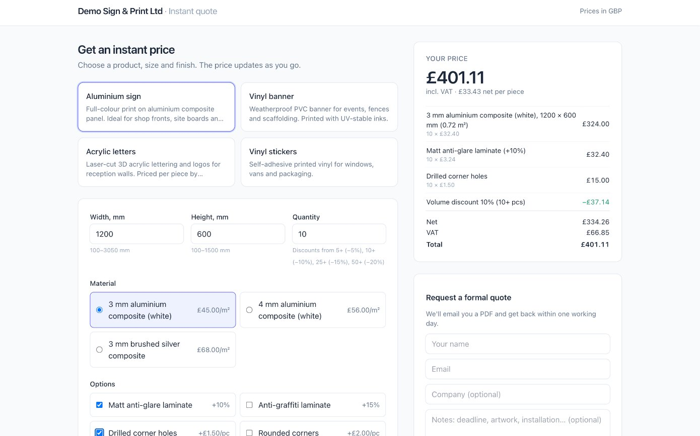
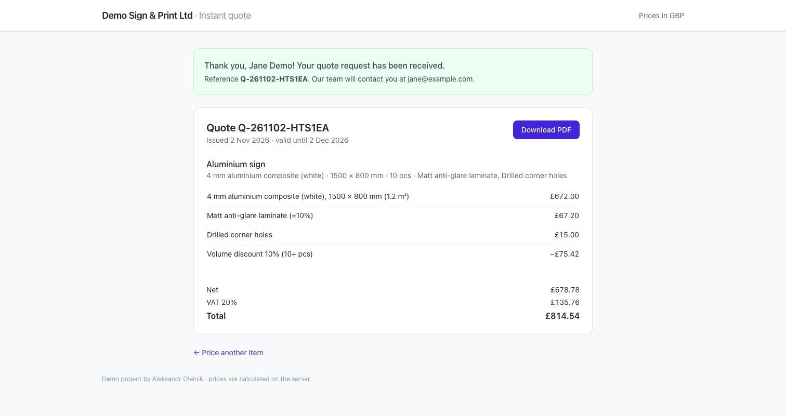
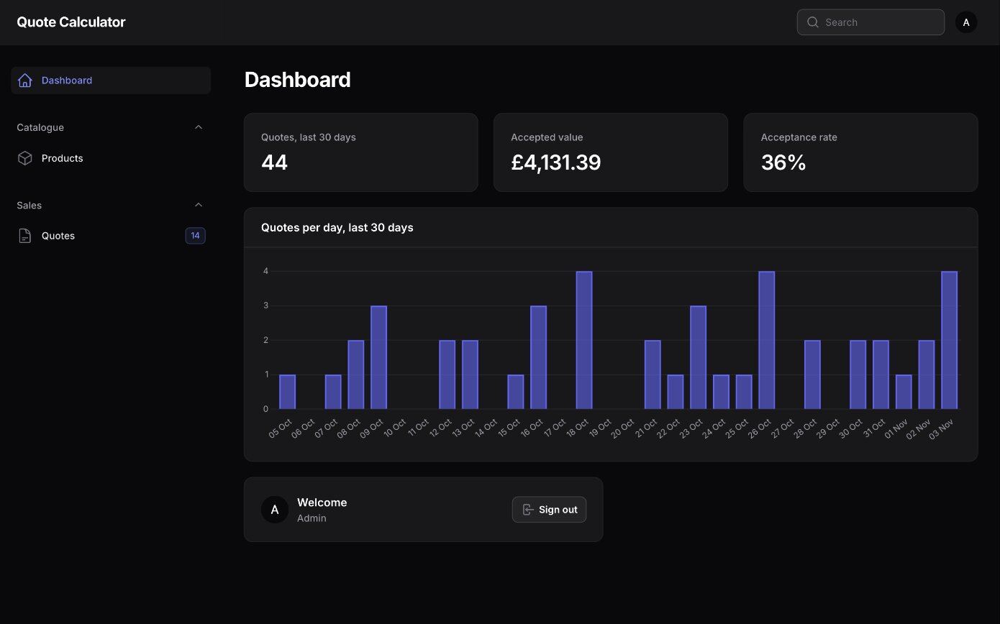
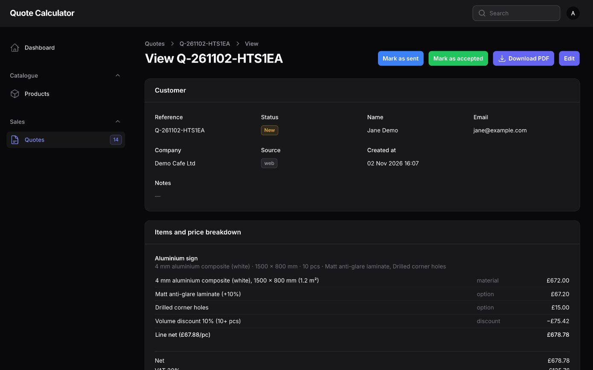

# Quote Calculator

A configurable product price calculator and quote builder for sign shops and print shops, built with **Laravel 12**, **Filament 3**, **Alpine.js** and **DomPDF**.

Customers pick a product (an aluminium sign, a vinyl banner, acrylic letters…), enter the size, choose a material and finishing options, and see a live price with a line-by-line breakdown. One click turns it into a formal quote: it is saved with a frozen price snapshot, the sales manager gets an email with the PDF attached, and the customer can download the PDF straight away.

The same pricing engine is exposed through a small REST API, so the calculator can be embedded in WooCommerce/WordPress or any other storefront **without the browser ever deciding the price**.

> Demo project by **Aleksandr Oleinik**, a freelance PHP/Laravel developer.

**Live demo: https://calc.clientus.vip** (the admin panel at `/admin` is private).

---

## Screenshots

| Public calculator with live, server-side price breakdown | Saved quote with frozen price snapshot and PDF download |
|---|---|
|  |  |

| Admin dashboard: quote stats and quotes per day (Filament) | Admin quote view with line-by-line breakdown and status actions |
|---|---|
|  |  |

---

## Features

- **Pricing engine**: a pure, deterministic and fully unit-tested service
  - size (width × height in mm) with per-product min/max limits
  - materials priced **per m²** or **per unit**
  - options as a **fixed fee** (once per line), a **percent** surcharge on the material or a **per-unit** amount
  - **quantity tiers** (volume discounts); the highest tier reached applies
  - **minimum order** price, configurable **rounding** step and a **VAT** toggle
  - returns a **line-by-line breakdown** whose lines always add up to the net total
- **Server-side only pricing**: the client sends IDs and dimensions, never amounts. Every price is recomputed from the database.
- **Quote snapshots**: each quote item stores product, material and option names plus the full breakdown, so later catalogue edits or deletions never change an issued quote.
- **Public calculator** (Blade + Alpine.js + Tailwind CDN, no npm build) with a live price, breakdown and a "Request quote" form.
- **PDF quotes** (barryvdh/laravel-dompdf), served on **signed URLs** so references can't be enumerated.
- **Manager email notification** with the PDF attached (the `log` mailer in development).
- **Filament 3 admin**: CRUD for products, materials, options and quantity tiers (as relation managers), and a quote list with status (new, sent or accepted), breakdown view and PDF download. Access is limited to `is_admin` users.
- **REST API** guarded by an API key: list products, calculate a price and create a quote with multiple items.
- **Quality**: PHPUnit unit and feature tests, Laravel Pint, PHPStan (Larastan) at level 8.

---

## Architecture

```
app/
├── Pricing/                  ← framework-free pricing core
│   ├── PricingEngine.php     ← calculate(PricingInput): PriceBreakdown
│   ├── PricingException.php  ← invalid configuration (carries the input field name)
│   └── Data/                 ← readonly DTOs: PricingInput, SizeLimits, MaterialPrice,
│                               OptionPrice, QuantityTier, BreakdownLine, PriceBreakdown
├── Actions/
│   ├── PriceItem.php         ← resolves IDs against the live catalogue → PricingInput → engine
│   └── CreateQuote.php       ← prices all items, stores Quote + QuoteItems in a transaction, emails manager
├── Enums/                    ← PricingUnit, OptionType, QuoteStatus
├── Http/
│   ├── Requests/             ← Form Requests (shape validation; shared item rules)
│   ├── Controllers/          ← thin web and API controllers
│   ├── Resources/            ← API/JSON representations
│   └── Middleware/EnsureApiKey.php
├── Filament/Resources/       ← admin panel (products + relation managers, quotes)
├── Mail/QuoteRequested.php
└── Services/QuotePdf.php
```

### Pricing engine

`App\Pricing\PricingEngine` has no database or framework dependencies: it receives a fully resolved `PricingInput` and returns a `PriceBreakdown`. All money is **integer cents** and all rates are **integer basis points** (`1500` = 15%), so there is no floating-point drift. Rounding is half-up at each step that produces a fraction.

Order of operations:

1. **Material per piece**: `width × height (m²) × price per m²`, or a flat price for per-unit materials.
2. **Per-piece options**: percent options are a surcharge on the material price; per-unit options add a flat amount to each piece.
3. **Quantity**: the per-piece total × quantity, minus the **best matching tier discount** (the tier with the highest `min_quantity` ≤ quantity).
4. **Fixed fees** (e.g. artwork design or express production) are added once per line and are not discounted.
5. **Rounding** of the net to the configured step (`QUOTECALC_ROUNDING_STEP_CENTS`); any difference is shown as its own line.
6. **Minimum order**: if the net is below the product minimum, a "Minimum order top-up" line is added.
7. **VAT** on the final net, when requested.

Worked example (seeded "Aluminium sign", 1200 × 600 mm, 3 mm composite at £45/m², matt laminate +10%, drilled holes £1.50/pc, quantity 10, 10% tier):

| Line | Amount |
|---|---:|
| 3 mm aluminium composite (white), 1200 × 600 mm (0.72 m²): 10 × £32.40 | £324.00 |
| Matt anti-glare laminate (+10%): 10 × £3.24 | £32.40 |
| Drilled corner holes: 10 × £1.50 | £15.00 |
| Volume discount 10% (10+ pcs) | −£37.14 |
| **Net** | **£334.26** |
| VAT 20% | £66.85 |
| **Total** | **£401.11** |

The engine refuses to price an invalid configuration (size outside limits, quantity below 1) by throwing `PricingException` with the offending field. `bootstrap/app.php` maps it to a normal validation error, so web forms redirect back with errors and the API answers `422` with `errors.width_mm`, etc.

### Server-side calculation

The browser and API clients only send `product_id`, `material_id`, `option_ids`, `width_mm`, `height_mm`, `quantity` and `include_vat`. `PriceItem` loads the **active** product with its **active** materials and options, checks that every ID belongs to that product, and builds the engine input from database values. Any amount fields a client sends are ignored. A test covers exactly that.

### Snapshotting

`quotes` stores totals, currency, VAT rate and the VAT flag. `quote_items` stores the product, material and option **names**, dimensions, quantity, the full **breakdown JSON** and the unit, net, VAT and total amounts. `quote_items.product_id` is only a soft reference (`nullOnDelete`). Changing a material price, renaming an option or deleting a product leaves issued quotes untouched, and the PDF always renders from the snapshot.

### Data model

```
products ─┬─< materials        (pricing_unit: per_m2 | per_unit, price_cents)
          ├─< product_options  (type: fixed | percent | per_unit, value: cents or bps)
          └─< quantity_tiers   (min_quantity, discount_bps)

quotes ───< quote_items        (snapshot: names, size, qty, breakdown JSON, amounts)
```

---

## REST API

All endpoints require the `X-Api-Key` header matching `QUOTECALC_API_KEY` in `.env`. If the key is empty, the API is locked (`401`). Send `Accept: application/json`.

```bash
export API=http://localhost:8000/api
export KEY=your-api-key
```

### `GET /api/products`

Active products with size limits, materials, options and tiers.

```bash
curl -s "$API/products" -H "X-Api-Key: $KEY" -H "Accept: application/json"
```

```json
{
  "data": [{
    "id": 1, "name": "Aluminium sign", "slug": "aluminium-sign",
    "size_limits_mm": {"min_width": 100, "max_width": 3050, "min_height": 100, "max_height": 1500},
    "min_order_cents": 2500,
    "materials": [{"id": 1, "name": "3 mm aluminium composite (white)", "pricing_unit": "per_m2", "price_cents": 4500}],
    "options": [{"id": 1, "name": "Matt anti-glare laminate", "type": "percent", "value": 1000}],
    "quantity_tiers": [{"min_quantity": 5, "discount_bps": 500}]
  }]
}
```

### `POST /api/quotes/calculate`

Prices one line. Nothing is saved.

```bash
curl -s -X POST "$API/quotes/calculate" \
  -H "X-Api-Key: $KEY" -H "Accept: application/json" -H "Content-Type: application/json" \
  -d '{"product_id":1,"material_id":1,"width_mm":1200,"height_mm":600,"quantity":10,"option_ids":[1,3],"include_vat":true}'
```

```json
{
  "product": {"id": 1, "name": "Aluminium sign"},
  "material": {"id": 1, "name": "3 mm aluminium composite (white)"},
  "options": [{"id": 1, "name": "Matt anti-glare laminate"}, {"id": 3, "name": "Drilled corner holes"}],
  "width_mm": 1200, "height_mm": 600, "currency": "GBP",
  "quantity": 10, "area_m2": 0.72, "discount_bps": 1000,
  "lines": [
    {"type": "material", "label": "3 mm aluminium composite (white), 1200 × 600 mm (0.72 m²)", "quantity": 10, "unit_amount_cents": 3240, "amount_cents": 32400, "amount_formatted": "£324.00"},
    {"type": "option", "label": "Matt anti-glare laminate (+10%)", "quantity": 10, "unit_amount_cents": 324, "amount_cents": 3240, "amount_formatted": "£32.40"},
    {"type": "option", "label": "Drilled corner holes", "quantity": 10, "unit_amount_cents": 150, "amount_cents": 1500, "amount_formatted": "£15.00"},
    {"type": "discount", "label": "Volume discount 10% (10+ pcs)", "quantity": null, "unit_amount_cents": null, "amount_cents": -3714, "amount_formatted": "−£37.14"}
  ],
  "unit_net_cents": 3343, "net_cents": 33426,
  "vat_rate_bps": 2000, "include_vat": true, "vat_cents": 6685, "total_cents": 40111,
  "formatted": {"unit_net": "£33.43", "net": "£334.26", "vat": "£66.85", "total": "£401.11"}
}
```

Validation errors use the standard Laravel `422` format:

```json
{"message": "Width must be between 100 and 3050 mm.", "errors": {"width_mm": ["Width must be between 100 and 3050 mm."]}}
```

### `POST /api/quotes`

Creates a quote with one or more items (max 20), emails the manager and returns signed links to the quote page and PDF.

```bash
curl -s -X POST "$API/quotes" \
  -H "X-Api-Key: $KEY" -H "Accept: application/json" -H "Content-Type: application/json" \
  -d '{
    "customer": {"name": "Jane Doe", "email": "jane@example.com", "company": "Acme Ltd"},
    "notes": "Needed by Friday",
    "include_vat": true,
    "items": [
      {"product_id": 1, "material_id": 1, "width_mm": 1200, "height_mm": 600, "quantity": 10, "option_ids": [1, 3]},
      {"product_id": 2, "material_id": 4, "width_mm": 3000, "height_mm": 1000, "quantity": 2}
    ]
  }'
```

Response `201 Created`:

```json
{
  "data": {
    "reference": "Q-261102-7KQ2ZD", "status": "new", "currency": "GBP",
    "net_cents": 40626, "vat_cents": 8125, "total_cents": 48751,
    "items": [{"product_name": "Aluminium sign", "quantity": 10, "net_cents": 33426, "lines": ["…"]}],
    "view_url": "https://…/quotes/Q-261102-7KQ2ZD?signature=…",
    "pdf_url": "https://…/quotes/Q-261102-7KQ2ZD/pdf?signature=…"
  }
}
```

Pricing errors in a specific item are reported against its index, e.g. `errors["items.1.height_mm"]`. The whole request is rejected and nothing is saved.

---

## Plugging into WooCommerce

The API key is a server-side secret, so WordPress talks to the calculator **from PHP**, never from the browser. The WooCommerce cart price is set from the server's answer, so a customer can't tamper with it.

A minimal must-use plugin (`wp-content/mu-plugins/quotecalc.php`). This is a sketch rather than a packaged plugin:

```php
<?php
/**
 * Plugin Name: Quote Calculator bridge
 * Prices configurable sign products through the Quote Calculator API.
 */

const QUOTECALC_API = 'https://quotes.example.com/api';
// Define QUOTECALC_API_KEY in wp-config.php, never in theme JS.

function quotecalc_calculate(array $config): ?array {
    $response = wp_remote_post(QUOTECALC_API . '/quotes/calculate', [
        'timeout' => 10,
        'headers' => [
            'X-Api-Key'    => QUOTECALC_API_KEY,
            'Accept'       => 'application/json',
            'Content-Type' => 'application/json',
        ],
        'body' => wp_json_encode($config),
    ]);
    if (is_wp_error($response) || wp_remote_retrieve_response_code($response) !== 200) {
        return null;
    }
    return json_decode(wp_remote_retrieve_body($response), true);
}

// 1. When the configurator form is added to the cart, price it on the server.
add_filter('woocommerce_add_cart_item_data', function (array $data, int $productId) {
    $config = [
        'product_id'  => (int) get_post_meta($productId, '_quotecalc_product_id', true),
        'material_id' => absint($_POST['qc_material_id'] ?? 0),
        'width_mm'    => absint($_POST['qc_width_mm'] ?? 0),
        'height_mm'   => absint($_POST['qc_height_mm'] ?? 0),
        'quantity'    => max(1, absint($_POST['quantity'] ?? 1)),
        'option_ids'  => array_map('absint', (array) ($_POST['qc_option_ids'] ?? [])),
    ];
    $price = quotecalc_calculate($config);
    if ($price === null) {
        throw new Exception(__('This configuration cannot be priced.', 'quotecalc'));
    }
    $data['quotecalc'] = ['config' => $config, 'net_cents' => $price['net_cents'], 'lines' => $price['lines']];
    return $data;
}, 10, 2);

// 2. Use the server price for the line. Woo multiplies by quantity, so set the price per piece.
add_action('woocommerce_before_calculate_totals', function (WC_Cart $cart) {
    foreach ($cart->get_cart() as $item) {
        if (isset($item['quotecalc'])) {
            $item['data']->set_price($item['quotecalc']['net_cents'] / 100 / $item['quantity']);
        }
    }
});

// 3. Show the breakdown in the cart and checkout.
add_filter('woocommerce_get_item_data', function (array $meta, array $item) {
    foreach ($item['quotecalc']['lines'] ?? [] as $line) {
        $meta[] = ['name' => $line['label'], 'value' => $line['amount_formatted']];
    }
    return $meta;
}, 10, 2);
```

For a live price on the product page, add a small `admin-ajax`/REST proxy in the same plugin that forwards the form to `/quotes/calculate`. The key stays on the server. To prevent Woo's quantity field from bypassing tiers, keep the quantity in the configuration and lock the cart quantity for these items, or re-price in step 2 when the quantity changes. Repricing on every cart calculation is also the place to pick up catalogue changes.

---

## Running locally

Requirements: PHP 8.2+ with `pdo_sqlite`, `intl`, `gd`, `zip` and `mbstring`, plus Composer 2.

```bash
git clone <this repo> quotecalc && cd quotecalc
composer install
cp .env.example .env
php artisan key:generate
# set QUOTECALC_API_KEY in .env, e.g.:  php -r "echo bin2hex(random_bytes(24)), PHP_EOL;"
touch database/database.sqlite
php artisan migrate --seed
php artisan serve
```

- Calculator: <http://localhost:8000/>
- Admin: <http://localhost:8000/admin>. The seeder creates `admin@quotecalc.test` with a **random password** written to `.admin-credentials.local` (git-ignored). Running `php artisan db:seed` again rotates it.
- Emails go to `storage/logs/laravel.log` (`MAIL_MAILER=log`).

Configuration lives in `config/quotecalc.php` and the `QUOTECALC_*` variables in `.env.example`: currency, VAT rate, rounding step, manager email, quote validity and company details for the PDF.

## Tests and code quality

```bash
php artisan test                       # PHPUnit: unit + feature
vendor/bin/pint --test                 # code style (Laravel preset)
vendor/bin/phpstan analyse --memory-limit=1G   # Larastan, level 8
```

What is covered:

- **Pricing engine (unit)**: area and per-unit materials, half-up rounding, percent vs per-unit vs fixed options, tier boundaries (below, exactly on, between and above), unordered tiers, discount scope, minimum order (below, equal, after discount), VAT on and off and its rounding, rounding step up and down, size limits including exact boundaries, quantity < 1, and the invariant that breakdown lines sum to the net.
- **API**: key required, wrong or empty key, product listing, calculate (breakdown, no save, client-sent prices ignored, validation, foreign material, inactive option or product, minimum order), create quote (multi-item, signed PDF link, manager email, per-item error paths, atomicity, snapshot surviving price changes and product deletion).
- **Web**: calculator page, live price endpoint, quote request → signed page → PDF download, signature required, validation errors, mail with attachment.
- **Admin**: guests redirected to login, non-admins forbidden, admins can open the dashboard, products, product edit with relation managers, quotes and the quote breakdown.
- **Seeders**: the demo data seeds cleanly.

## Deployment

The repository includes a production setup (not used for local development):

- `Dockerfile`: multi-stage build (Composer → `php:8.2-fpm-alpine` with `intl`, `gd`, `zip`, `pdo_sqlite` and OPcache).
- `docker-compose.yml`: `app` (PHP-FPM) + `web` (Nginx 1.27), with SQLite and storage on named volumes.
- `docker/nginx/default.conf`, `docker/php/php.ini`, `docker/php/entrypoint.sh` (migrations, config/route/view cache, publishes public assets to Nginx).

```bash
cp .env.example .env.production   # set APP_KEY, APP_URL, APP_ENV=production, QUOTECALC_API_KEY, real MAIL_* settings
docker compose up -d --build
docker compose exec app php artisan db:seed --force   # first run only (demo data + admin)
```

Notes for production:

- Terminate TLS in front of Nginx (Caddy, Traefik or a cloud load balancer) and set `APP_URL` to the HTTPS URL, because signed quote links depend on it.
- Swap SQLite for MySQL/PostgreSQL by changing `DB_*`. The schema is portable.
- Use a real mailer (SMTP, SES or Postmark). For high volume, make `QuoteRequested` queued and run a queue worker.
- The public calculator uses the Tailwind Play CDN for convenience. For production, compile Tailwind with Vite.

## License

MIT. See [LICENSE](LICENSE).

## Author

**Aleksandr Oleinik**, freelance PHP/Laravel developer

- Website: [clientus.vip](https://clientus.vip)
- GitHub: [github.com/AleksandrOleinik-git](https://github.com/AleksandrOleinik-git)
